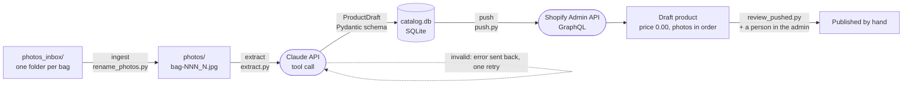
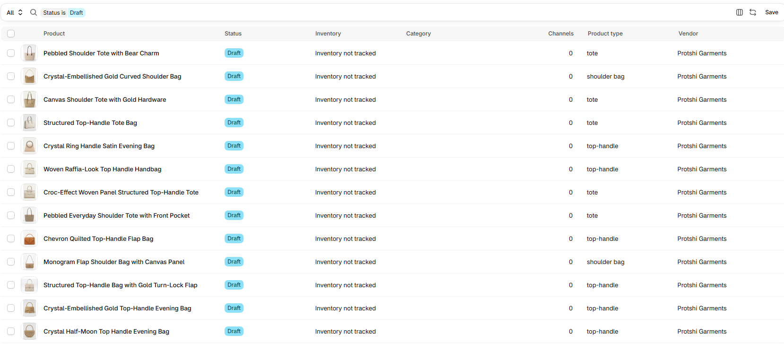
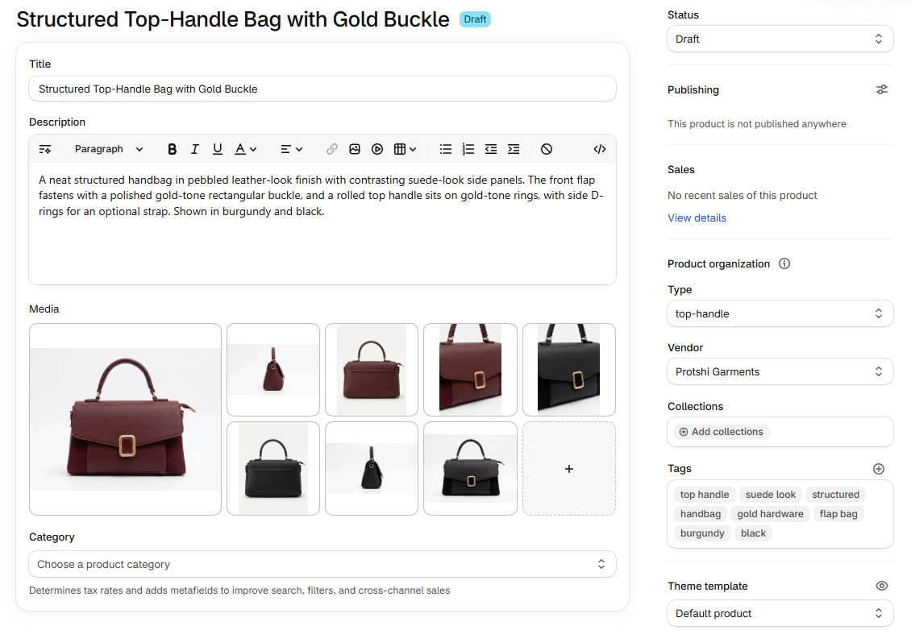

# Protshi agent

Protshi agent turns raw product photos into review-ready Shopify draft listings for
**Protshi Garments**, a real bag store in Beirut, Lebanon. You sort the photos into one
folder per bag; the pipeline renames them, sends each bag's photos to the Claude API for a
title, description, tags and SEO text that must pass a strict schema, stores the result in a
SQLite catalog, and creates the product in Shopify as a **draft** with all its photos in
order, so a person approves every listing before it goes live. Headline number: the store's
full catalogue of **26 bags (109 photos) became Shopify drafts for $1.36 in total, about
$0.05 and 7 seconds of extraction per bag**, with 26 of 26 drafts passing review.

## How it works



- **ingest** copies each sorted folder to `photos/` as `bag-001_1.jpg, bag-001_2.jpg …` and
  registers the bag as `pending`. Rules, no model: the grouping is exact, so code does it.
- **extract** sends one bag's photos to Claude, forced to answer through a tool whose input
  is the `ProductDraft` schema. An invalid answer is sent back once with the errors.
  Bags already extracted with the same photos are skipped, so a rerun costs nothing.
- **push** uploads the photos and creates the product as a `DRAFT`. The Shopify id is stored
  at once, so a bag is never created twice.
- Every stage reads and writes `catalog.db` (`pending → extracted → pushed`, or `failed`
  with the error), and logs one line per bag to the screen and to `logs/run.log`.

## Quickstart

Python 3.13, a Claude API key, and a Shopify app with `read_products` and `write_products`.

```bash
git clone https://github.com/Alihabhab55/protshi-agents.git && cd protshi-agents
python -m venv .venv && .venv\Scripts\activate          # macOS/Linux: source .venv/bin/activate
pip install -r requirements.txt
copy .env.example .env                                   # macOS/Linux: cp; then fill in the four keys
python run.py --stage all --limit 1                      # dry run; add --confirm to do it for real
```

Put your photos in `photos_inbox/`, one subfolder per bag. Every command is a **dry run by
default**: it shows what it would copy, send or create, and changes nothing until you add
`--confirm`. Run the tests with `pytest`.

## Results

The whole catalogue, with `claude-opus-5` at low effort (November 2026):

| Metric | Result |
|---|---|
| Bags processed | 26 bags, 109 photos (1 to 12 per bag) |
| Success rate | 26 / 26 extracted and pushed (100%); 22 / 26 on the first run, see below |
| Cost per bag | $0.052 average, $0.023 for 1 photo, $0.215 max (12 photos, one retry) |
| Total cost | $1.36 in Claude API usage; pushing to Shopify costs nothing |
| Seconds per bag | ≈ 7 s to extract, ≈ 11 s to push (mostly Shopify processing photos) |
| Rerun of a finished catalogue | 0 model calls, 0 new products, $0.00 |
| Drafts passing review | 26 / 26: draft, price 0.00, every photo READY |

The 4 first-run failures were 7 photos named `.PNG` that were really JPEGs; the API checks
the bytes and refused them. The run carried on, the type is now read from the file's bytes,
and only those 4 bags were sent again. Every failure and its fix is written down in
[NOTES.md](NOTES.md).

## Screenshots

The 26 drafts in the Shopify admin:



One draft as created by the pipeline: title, description, tags, SEO and photos in order.



## Safety by design

- **Dry run by default**, `--confirm` to act. **Draft only**: nothing is ever published.
- **Secrets stay out of git**: keys live in `.env`, which is ignored; `.env.example` lists
  the variable names only. The Shopify app has product scopes only.
- **Idempotent**: unchanged bags are skipped and pushed bags are never pushed again.
- **One bad bag never stops the run**: it is saved as `failed` with its error and retried
  next time.

## Project layout

| File | Role |
|---|---|
| `run.py` | One entry point: `--stage` ingest, extract, push or all |
| `rename_photos.py` | ingest: sorted folders to `photos/bag-NNN_N.jpg` |
| `extract.py` | extract: Claude tool call, validation, one retry, cost per bag |
| `schema.py` | `ProductDraft`, the schema every listing must pass |
| `catalog.py` | the SQLite catalog: statuses, upserts, migrations |
| `push.py`, `shopify_api.py` | push: staged photo uploads, `productCreate` as a draft |
| `review_pushed.py` | reads each pushed draft back and checks it against the catalog |
| `tests/` | `pytest`: schema, grouping, draft payload, skip rule |
| `NOTES.md` | the engineering log: every decision, failure and fix, day by day |
